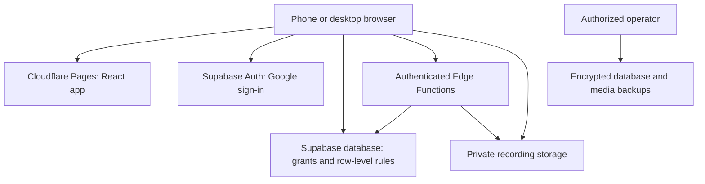

# Little Bloom: Detailed Web App Implementation Plan

**Date:** October 31, 2026  
**Status:** Proposed implementation specification; application not yet built  
**Delivery:** Mobile-first web application  
**Service budget:** $0 recurring service cost for the initial pilot  
**Initial capacity:** 25 families, with one account owner and at most one invited partner per family

This document expands [the free-service plan](./LITTLE_BLOOM_FREE_SERVICE_PLAN.md). It supersedes earlier recommendations for paid infrastructure, email services, subscriptions, and a Next.js runtime. It preserves the product's core purpose: short prenatal education and bonding experiences, optional partner participation, and private family memories.

All scope, schedules, capacity targets, and success thresholds below are planning decisions. They are not evidence of clinical effectiveness, customer demand, or an existing deployment.

## 1. Product objective

Help expecting adults understand selected aspects of pregnancy and enjoy short moments of connection through reading, conversation, gentle relaxation, and personal memories.

The core journey is:

**Understand something briefly -> choose an activity -> enjoy the experience -> optionally save a memory.**

The first release must establish whether families:

1. Understand the product without assistance.
2. Complete a meaningful first activity.
3. Return voluntarily on another day.
4. Find memories and partner participation useful.
5. Want the experience to continue after the pilot.

The app does not diagnose pregnancy conditions, monitor fetal health, assess fetal learning, or promise improvements in intelligence. Fourteen activities form an editorial program, not a medically prescribed schedule. Skipping an activity must not imply harm or failure.

## 2. Working assumptions and boundaries

| Decision | Initial assumption |
|---|---|
| Audience | Adult expecting parents and their invited partners |
| Language | English |
| Devices | Phone browser first; tablet and desktop supported |
| Pilot recruitment | 25 families recruited directly by the owner |
| Account access | Google sign-in; guests can try samples |
| Program | 14 activities, completed in any order and at any pace |
| Pregnancy details | Optional due date or self-selected stage; never required for guest use |
| Family structure | One owner and one partner; solo use fully supported |
| Notifications | In-app messages; optional calendar-file download |
| Connectivity | Online use; clear connection errors |
| Monetization | No payments or paywalls during the pilot |
| Geography | Select one initial recruitment country before public release |
| Content | Small curated collection with documented rights and review |
| Medical review | Separate human responsibility; infrastructure choice does not provide it |

Global English-language availability is a future distribution direction. Country-specific clinical guidance, emergency contacts, and legal applicability must not be inferred from the user's timezone.

## 3. Scope and priorities

### 3.1 Required for the private beta

| Module | Included behavior |
|---|---|
| Public website | Explain the product, show a sample, describe privacy and pilot access |
| Guest experience | Complete sample activities without creating a cloud account |
| Onboarding | Optional stage, preferences, and solo/shared-use choice |
| Authentication | Google sign-in, session handling, and sign-out |
| Today | Continue the program, choose an alternative, see a short insight |
| Explore | Filter activities and read supporting educational cards |
| Activity player | Read instructions or scripts; play the small audio collection |
| Progress | Mark completion, repeat an activity, manage favorites |
| Memories | Save, edit, download, and delete text notes or short recordings |
| Partner access | Invite, accept, contribute, share explicitly, and revoke |
| Settings | Update preferences, pause pregnancy content, export, and delete |
| Administration | Manage content, review versions, and inspect aggregate pilot usage |
| Operations | Quota checks, manual backups, restoration procedure, incident handling |

### 3.2 Deferred

- AI chat, generated stories, transcription, and automatic translation.
- Medical diagnosis, fetal heartbeat recording or interpretation, symptom assessment, and movement scoring.
- Videos, photos, 3D fetal models, audio editing, and large music libraries.
- Public communities, messaging feeds, multiple partners, and extended-family groups.
- Email or SMS reminders and invitations.
- Web push, full offline operation, and background audio guarantees.
- Payment processing, subscriptions, custom domains, and paid integrations.
- Native iOS and Android applications.

The team should finish the required experience before adding deferred features.

## 4. Free-service architecture

| Layer | Selection | Responsibility |
|---|---|---|
| Frontend | React, Vite, TypeScript | Responsive application and public pages |
| Routing | React Router | Browser navigation and protected route presentation |
| Styling | Tailwind CSS and accessible open-source components | Reusable interface system |
| Hosting | Cloudflare Pages Free | Static frontend and public editorial assets |
| Address | Included `pages.dev` address | Avoid domain registration cost |
| Database | Supabase PostgreSQL Free | Content, membership, progress, and memories |
| Authentication | Supabase Auth with Google OAuth | User identity and sessions |
| Private files | Supabase Storage Free | Voice recordings |
| Privileged operations | Minimal Supabase Edge Functions within Free allowances | Protected uploads, deletion, and other admin-only operations |
| Transactional rules | PostgreSQL functions and constraints | Atomic invitations and quota reservations |
| Content management | Custom admin interface | No separate CMS |
| Reporting | Aggregate queries and narrowly defined events | No external analytics subscription |
| Tests | Vitest, Playwright, and database authorization tests | Local verification |
| Recovery | Encrypted manual database and media exports | No paid backup provider |



Arrows represent authorized communication, not unrestricted access. Browser access to private storage requires storage policies. Privileged credentials belong only in backend secrets or controlled local operator tools.

Use no Cloudflare Pages Functions for the initial application. Supabase functions should perform short, bounded operations; do not introduce heavy media transcoding. Current Edge Function documentation describes a two-second CPU limit per request and a Free worker duration limit of 150 seconds. These are constraints, not targets to consume. [S6]

## 5. Service limits and cost controls

### 5.1 Provider allowances

The following were verified in the planning conversation on October 31, 2026. Recheck the referenced provider pages before provisioning.

| Service | Free allowance or limitation |
|---|---|
| Cloudflare Pages | 500 builds per month; individual static assets up to 25 MiB |
| Supabase database | 500 MB |
| Supabase file storage | 1 GB |
| Supabase authentication | 50,000 monthly active users |
| Supabase delivery | 5 GB egress and a separate 5 GB cached-egress allowance |
| Supabase projects | Two active Free projects |
| Supabase inactivity | Free projects may pause after one week of inactivity |
| Supabase default email | Restricted recipients; not suitable for public signup |

Sources: [S1], [S2], [S3]. Different allowances are not interchangeable. A high authentication allowance does not imply enough audio storage or bandwidth for that many users.

### 5.2 Application limits

| Resource | Application rule |
|---|---|
| Families | Maximum 25 approved pilot families |
| Membership | One owner and one active partner per family |
| Recordings | Maximum 10 stored recordings per family |
| Recording file | Maximum 2,000,000 bytes |
| Recording duration | Recorder stops at two minutes; duration is a UX limit, not the sole quota control |
| Family recording storage | Maximum 20,000,000 bytes, including pending upload reservations |
| Text memories | Maximum 100 per family during pilot; 2,000 characters each |
| Invitations | One pending invitation per family; proposed expiry of 48 hours |
| Guest progress | Temporary session state; no cloud persistence |
| Upload behavior | One active recording upload per user |

Maximum recorded audio under these limits is 25 x 10 x 2 MB = **500 MB** in decimal units. Leave the remaining allocation for headroom rather than increasing quotas immediately. A 500 MB library played ten times transfers approximately 5 GB before considering other traffic; repeated playback can exhaust delivery allowance before storage is full.

Enforce storage bytes and counts on the server. Client-reported duration is not a trustworthy security boundary. Set the private bucket's actual per-file cap to 2 MB and enforce a constrained set of audio types. Supabase supports per-bucket file-size limits. [S7]

### 5.3 Operating thresholds

- At 60% of any limiting allowance: investigate usage and update the forecast.
- At 75%: stop expanding the pilot and assess safe reductions in transfer or storage.
- At 85%: consider temporarily disabling new uploads or registrations while preserving read/export access where possible.
- Do not automatically delete memories to reduce usage.
- Do not enable paid upgrades, paid add-ons, or billing-based overflow.
- Do not create synthetic activity just to circumvent inactivity policies.

These are proposed internal thresholds, not provider behavior. Free limits can still interrupt availability. Explain temporary outages plainly and maintain recovery procedures.

## 6. Navigation and screen specification

Primary phone navigation: **Today, Explore, Memories, You**. Desktop uses the same destinations in a sidebar.

| Route | Screen | Required content and actions |
|---|---|---|
| `/` | Homepage | Clear promise, example experience, guest CTA, privacy summary |
| `/sample` | Guest activity | Complete one of three samples without signup |
| `/sign-in` | Login | Google sign-in, privacy links, understandable failure states |
| `/auth/callback` | Login return | Restore intended destination; prevent external redirect injection |
| `/onboarding` | Setup | Optional stage/date, preferences, solo/shared choice |
| `/today` | Dashboard | Next incomplete activity, alternative activity, reviewed insight |
| `/explore` | Library | Categories, duration labels, favorites, empty search state |
| `/activities/:slug` | Activity | Purpose, script/instructions, completion, optional reflection |
| `/learn/:slug` | Education | Reviewed text, sources, reviewer, review date |
| `/memories` | Memory library | Private/shared badges, own/partner filters, empty state |
| `/memories/new` | Memory creation | Text or recording, preview, explicit sharing choice |
| `/memories/:id` | Memory detail | Playback/read, own-entry edit/delete, export |
| `/family` | Family access | Partner status, invitation, permissions, revoke |
| `/join` | Invitation acceptance | Token handling, login, accept/decline, expired-link state |
| `/settings` | Preferences | Stage/date, pause, profile, sign-out |
| `/settings/privacy` | Data controls | Export, deletion, sharing explanation |
| `/help` | Help | Product support, recording help, reviewed medical-help information |
| `/privacy` | Privacy notice | Data, services, sharing, retention, and rights |
| `/terms` | Pilot terms | Scope, participation, availability, and acceptable use |
| `/admin` | Editorial dashboard | Role-protected queue and aggregate reports |
| `/admin/content/:id` | Editor/reviewer | Draft, sources, review, publish, withdraw |

Every interactive screen needs loading, empty, error, success, and retry states. Route protection is only presentation; database and storage authorization must remain effective when requests bypass the UI.

### 6.1 Design requirements

- Warm ivory background, restrained peach and sage accents, readable dark text.
- One readable sans-serif family initially; use system fonts or self-host a properly licensed font.
- Favor text clarity over decorative illustrations.
- Maintain clear keyboard focus and accessible control names.
- Provide transcripts for prerecorded audio.
- Support enlarged text and reduced motion.
- Use text labels as well as color to indicate private/shared or saved/failed states.
- Test narrow phone widths, tablet layouts, and desktop without horizontal overflow.
- Do not ask for microphone permission during onboarding.
- Never auto-play audio on entry.

## 7. User journeys and acceptance criteria

### 7.1 Guest tries the experience

1. Visitor selects Try an activity.
2. They can optionally select a pregnancy stage or continue without one.
3. They read a script or complete an activity.
4. Completion offers another sample or sign-in to save future progress.

**Acceptance:** No account or pregnancy data required; no cloud memory created; no automatic microphone prompt. Guest state is temporary and clearly not synchronized.

### 7.2 Parent creates an account

1. Google OAuth identifies the user.
2. The app checks pilot eligibility.
3. Eligible users create a family and optional pregnancy preferences.
4. Today opens with the first suggested activity.

**Acceptance:** Login retry does not duplicate families; rejected pilot access gives a clear message; optional questions can be skipped. Request only basic identity scopes. Complete Google's audience and branding setup and verify the free hosting address works before committing to the rest of the login implementation. [S4]

### 7.3 Parent completes or repeats an activity

1. Open an activity from Today or Explore.
2. Choose solo or together instructions where available.
3. Read or play content; pause and resume freely.
4. Mark complete manually.
5. Optionally favorite it or create a memory.

**Acceptance:** Completing twice does not duplicate the completion record. Repeating an activity is allowed. A user can undo completion. The program does not lock days or penalize missed sessions.

### 7.4 Parent records a memory

1. Select Record and grant microphone permission.
2. Record up to two minutes; stop automatically or manually.
3. Preview, retry, discard, or save.
4. Select private or shared; default is private.
5. Upload with progress and retry handling.
6. Show Saved only after the object and metadata are confirmed.

**Acceptance:** Stop microphone tracks when leaving the recorder; reject oversized files; retain a retryable local buffer while the page remains open; disclose that an unsaved buffer is lost if the page closes. Failed uploads do not create playable memories or consume a permanent slot.

### 7.5 Partner joins and contributes

1. Owner creates a single-use invitation and shares the link manually.
2. Partner signs in and accepts before expiry.
3. Partner sees shared activities and explicitly shared memories.
4. Partner creates a recording or note and chooses its visibility.

**Acceptance:** The token cannot be reused, guessed, or redeemed by two accounts. A third family member cannot join. The owner cannot read the partner's private memories. Only an author edits or deletes their own memory.

### 7.6 Pause, revoke, leave, or delete

- Pausing removes pregnancy-oriented recommendations and celebratory prompts while preserving access to memories.
- Revoking a partner immediately removes new access to the family owner's shared records.
- Partner-authored records remain accessible to that author but are unshared when membership ends; they continue consuming the original family quota until deleted or explicitly migrated by an operator.
- Owner account deletion closes the family, removes owner-authored data, and detaches partner-authored records into author-only access with guidance to export/delete. Do not silently transfer ownership.
- Partner deletion removes the partner's own data and membership without deleting owner-authored records.

**Acceptance:** Confirm destructive actions and list their effects. Previously downloaded files cannot be recalled. App access revocation must not promise deletion of a recipient's independent copy.

## 8. Content plan

### 8.1 Initial inventory

| Content | Target |
|---|---:|
| Core activities | 14 |
| Parent-read stories | 6 |
| Short relaxation recordings | 4, with transcripts |
| Reviewed education cards | 12 |
| Reflection prompts | 14 |
| Partner adaptations | Wherever appropriate |
| Guest samples | 3 activities from the program |

Prefer original stories and recordings. Maintain a rights register with asset creator, permission/license, attribution requirements, and allowed uses. A free download is not automatically licensed for reuse.

### 8.2 Proposed activity sequence

These are editorial concepts awaiting content review, not clinical instructions or a developmental treatment.

| Activity | Experience | Optional memory |
|---|---|---|
| 1 | Introduce yourself through a short spoken message | A welcome note |
| 2 | Read a brief original story | Favorite sentence |
| 3 | Take a comfortable quiet pause | How the moment felt |
| 4 | Share a family story | Short voice memory |
| 5 | Sing a familiar song in your own voice | A note about the song |
| 6 | Talk about a place important to your family | Description or reflection |
| 7 | Repeat a favorite activity | What you enjoyed |
| 8 | Read a second story together or alone | Optional recording |
| 9 | Share hopes without making promises about development | Private reflection |
| 10 | Invite a partner to read or speak | Shared memory |
| 11 | Explore an approved education card | A question for later discussion |
| 12 | Choose another quiet activity | Short reflection |
| 13 | Revisit a saved memory | Favorite moment |
| 14 | Choose a routine you want to continue | A closing note |

Do not encourage collecting copyrighted music recordings for redistribution. Audio guidance and health statements require review. Avoid movement-triggering challenges, fetal-response scores, and claims that any activity is necessary for healthy development.

### 8.3 Editorial workflow

`Draft -> Editorial review -> Clinical review if health-related -> Approved -> Published -> Revised or withdrawn`

Each version includes title, type, body/script, duration estimate, source links, audience/stage suitability, rights information, author, reviewer, review date, status, and revision note.

Changing a published health statement creates a new draft version. Approval applies to a specific version. Withdrawal removes the item from recommendations and public retrieval; the user's completion history can remain with a neutral unavailable-content label.

If a qualified reviewer is unavailable, use a prototype with clearly marked placeholder health content and do not treat it as a reviewed public release.

## 9. Personalization and progress rules

- Pregnancy stage is optional and separate from account identity.
- If an estimated due date is supplied, derive an approximate stage for content selection only; show that it is an estimate and allow correction.
- If the user supplies only a broad stage, do not silently advance it as though an exact date were known.
- Do not infer individual fetal health, size, hearing capability, or development from dates.
- Today suggests the next incomplete activity, filtered by approved suitability rules and preferences.
- If nothing fits, display a general activity rather than inventing personalized medical guidance.
- A paused profile receives a neutral dashboard and access to memories.
- Passing a due date must not automatically mark birth, send congratulations, or delete data.
- Content personalization is deterministic; no paid AI or health profiling.

## 10. Data model

All IDs should be non-sequential identifiers where appropriate. Use database timestamps, constraints, and explicit foreign keys. Keep the schema under version-controlled migrations.

| Table | Principal fields | Notes |
|---|---|---|
| `profiles` | `user_id`, display name, timezone, preferences, status | Keyed to authenticated identity; no duplicated email unless necessary |
| `families` | `id`, `owner_user_id`, pilot status, created time | Defines quotas and lifecycle |
| `family_memberships` | family, user, role, status | Unique active membership constraints |
| `pregnancy_profiles` | family, optional due date/stage, active/paused | Partner access limited to explicitly shared preferences |
| `family_invitations` | family, token hash, expiry, accepted/revoked timestamps | Raw token never stored or logged |
| `programs` | slug, title, published version | One pilot program initially |
| `activities` | stable activity ID, category, sample flag | Identity independent of content revision |
| `program_activities` | program, activity, position | Unique positions and membership |
| `content_versions` | content ID, version, body, metadata, status | Published read access only where appropriate |
| `content_reviews` | version, reviewer, result, timestamp | Approval linked to immutable reviewed version |
| `content_sources` | version, title, URL, access date | Public evidence references |
| `asset_licenses` | asset, creator, license, attribution | Editorial audio and illustration rights |
| `activity_progress` | user, activity, completed time | Unique user/activity completion |
| `favorites` | user, activity | Unique pair |
| `memories` | family, author, type, text, visibility, lifecycle state | Default author-only visibility |
| `media_assets` | memory, object key, actual bytes, MIME, status | No permanent public URL |
| `upload_reservations` | family, author, reserved bytes, expiry, state | Atomic quota accounting |
| `consent_records` | user, policy version, decision, time | Record actual consent choices without implying all processing requires consent |
| `pilot_events` | pseudonymous actor/family, event type, time | No private content payloads |
| `admin_roles` | user, editorial/reviewer/operator role | Not editable through user profile fields |
| `admin_audit_events` | actor, action, target ID, time, outcome | No journal or recording contents |
| `deletion_requests` | user, state, progress, retry metadata | Supports resumable removal |

Indexes should support family membership, memory author/family, content publication, activity progress, pending invitations, and active quota reservations. Do not expose raw reporting or administrative tables through broadly accessible views.

## 11. Authorization rules

| Resource | Guest | Parent/account owner | Partner | Editorial admin |
|---|---|---|---|---|
| Published samples | Read | Read | Read | Manage authorized content |
| Full pilot program | No | Read if admitted | Read if active member | Manage authorized content |
| Private note/recording | No | Own only | Own only | No routine access |
| Shared memory | No | Current family shared entries | Current family shared entries | No routine access |
| Pregnancy details | No | Manage own family details | Only explicit shared subset | No routine access |
| Family invitations | No | Create/revoke | Accept own invitation | No routine access |
| Membership removal | No | Revoke partner | Leave family | Controlled support operation only |
| Content drafts | No | No | No | Assigned role only |
| Aggregate reports | No | No | No | Approved reporting role |

Implement both explicit database grants and Row Level Security policies per operation. Protect storage separately. Privileged service credentials bypass ordinary RLS and must never enter browser bundles. Audit database views and security-definer functions as well as tables. [S8]

For security-definer functions, specify a safe search path, tightly restrict execution grants, and derive user identity from the verified session. Never trust a client-supplied owner ID or role claim stored in user-editable metadata.

## 12. Backend operations and consistency

The following names describe intended contracts, not completed APIs.

| Operation | Authentication and behavior |
|---|---|
| `create_family` | Admitted user only; atomic membership and capacity checks |
| `create_invitation` | Owner only; revoke/replace previous pending token; rate limit |
| `accept_invitation` | Signed-in user; hash lookup, expiry, one-time atomic acceptance |
| `revoke_partner` | Owner only; invalidate membership and future shared access |
| `complete_activity` | Pilot member; idempotent completion for own user |
| `reserve_recording_upload` | Active member; lock family quota and reserve slot/bytes |
| `upload_recording` | Validate session, reservation, size and accepted audio type; immutable object key |
| `finalize_recording` | Verify object metadata and activate the memory; safe to retry |
| `delete_memory` | Author only; deny future access, delete object, release usage, finish metadata removal |
| `export_my_data` | Author's own data; paginated and bounded |
| `request_account_deletion` | Recent authenticated confirmation; lifecycle rules from section 7 |
| `publish_content_version` | Authorized publisher; approved review and rights prerequisites |

### 12.1 Recording upload sequence

1. Generate an idempotency key for the user's save attempt.
2. Create a quota reservation in a database transaction with a family-level lock.
3. Count active assets plus unexpired reservations; reserve the actual intended bytes up to the per-file maximum.
4. Upload through a short authenticated backend handler. Do not allow arbitrary direct browser writes or overwrites to the recording bucket.
5. Apply bucket size restrictions and validate a supported audio container using bounded checks; do not perform heavy transcoding.
6. Write to an immutable, server-generated object key.
7. Confirm stored size/type and finalize metadata exactly once.
8. Release unused reservation bytes; expose the memory only after finalization.
9. Reconcile failed uploads and orphan objects through a documented operator task and opportunistic cleanup.

Object storage and database writes are not a single transaction. Track pending, active, failed, and deleting states explicitly. Database metadata alone must not claim that a file exists. An expired reservation must not release its bytes until any associated object is checked and removed.

The recording timer and browser duration checks provide UX limits. The authoritative free-tier protection is server-enforced byte/count limits. Do not claim robust server-side duration verification until implemented and tested for every accepted container.

### 12.2 Playback and revocation

Prefer authenticated object reads under storage policies. If temporary signed URLs are needed for browser playback, make them short-lived and explain the residual validity window in the permission design. Revoking membership prevents new access; it cannot recall a downloaded copy or instantly invalidate a still-valid bearer URL.

Do not put private audio in the public frontend build or cache it in a service worker. Browser buffers already delivered to a device cannot be treated as remotely erasable.

### 12.3 Invitation handling

Use high-entropy tokens and store only hashes. An invitation represents access, so avoid token logging, analytics, and third-party scripts on the acceptance page. Prefer a URL fragment and short-lived session handling rather than leaving tokens in referrers. Redemption is atomic, expires after the proposed 48 hours, and must fail after revocation or prior use.

## 13. Privacy and account lifecycle

### 13.1 Data minimization

- No medical history, symptom diary, precise location, advertising identifiers, or contact uploads.
- Optional pregnancy details are used only for the stated experience.
- Do not record private content in logs or analytics.
- Keep Google's identity scopes limited to basic sign-in needs.
- Separate editorial roles from operational access to private data.
- Review applicable privacy requirements for the actual pilot country before enrollment.

### 13.2 Proposed retention policy

| Data | Proposed behavior |
|---|---|
| Unsaved recordings | In-memory buffer only; discarded on close or explicit discard |
| Active memories | Retained until author deletion or the announced pilot closure process |
| Expired invitations | Clear token-bearing records after a short operational window |
| Raw pilot events | Retain up to 90 days; keep only non-identifying aggregates afterward |
| Operational logs | Target 30 days where configuration permits; disclose provider-managed exceptions |
| Operator backups | Two encrypted weekly generations; no indefinite archive |
| Deleted-account data | Remove active data promptly; complete backup expiry within the declared two-generation window |

These are proposed application policies, not claims about provider defaults. Verify provider-controlled logs, backups, and deletion behavior and document any differences before publishing the privacy notice.

### 13.3 Export and deletion

Export a JSON file of the user's profile, progress, and authored text entries, plus individually downloadable authored recordings. Include an index explaining the files. Do not require a large server-generated ZIP on the free runtime.

Deletion must immediately block new access while processing file and database removal. Retry failures safely and show status. Retain a minimal deletion ledger long enough to prevent deleted records from reappearing during restoration, then dispose of it according to policy.

Imported calendar reminders are independent copies in the user's calendar. Pausing the app cannot remove them. Explain how to delete them and use neutral event titles without sensitive pregnancy details.

## 14. Content administration and support

### Editorial roles

- **Editor:** Creates drafts and attaches sources and rights information.
- **Reviewer:** Records a review outcome for a specific content version.
- **Publisher:** Publishes approved versions or withdraws content.
- **Operator:** Manages quotas, deployment, recovery, and account lifecycle support.

One person may hold multiple roles, but the system must not confuse an editorial administrator with permission to browse private family recordings.

### Admin dashboard

- Draft/review queue and incomplete review metadata.
- Published content with version and last-reviewed date.
- Aggregate participation and return-use reports.
- Family count, reserved/used storage, and pending deletion/upload failures.
- A manual operational checklist for provider quotas and backups.

Use an existing owner-controlled support mailbox for the pilot; do not add an automated email platform. Support instructions should tell users not to email recordings or detailed health information.

## 15. Project structure and environments

```text
src/
  app/                 # router, layouts, providers
  components/          # accessible shared UI
  features/
    onboarding/
    auth/
    today/
    activities/
    education/
    memories/
    family/
    privacy/
    admin/
  lib/                 # clients, validation, recording helpers
  styles/
  types/
public/
  editorial-assets/    # public, licensed assets only
supabase/
  migrations/
  functions/
  tests/
  seed.sql             # synthetic data and approved/public fixtures only
tests/
  unit/
  e2e/
docs/
  content/
  decisions/
  operations/
```

### Environment policy

- Local development uses synthetic records and local services where practical.
- Use the available Free project allowance for separate staging and pilot projects if available in the owner's account.
- If only one hosted project is available, keep development local rather than mixing preview builds with private pilot data.
- Never copy real memories into test fixtures or public repositories.
- Only the public Supabase URL and publishable client key belong in frontend environment variables.
- Keep service credentials and Google client secrets out of frontend variables, source control, logs, and documentation.
- Pin dependencies and commit the lockfile when implementation begins.
- Run checks locally; external CI is optional and must stay on a verified free allowance.

## 16. Deployment and operations

### Initial setup

1. Create or select owner-controlled Free accounts; verify existing account quotas.
2. Create staging/pilot Supabase projects where the free allowance permits.
3. Apply migrations, grants, and policies before connecting public screens.
4. Create the private recording bucket with size/type restrictions.
5. Configure Google OAuth, consent audience, site URL, and exact redirect allowlists.
6. Test Google login on the free hosted address; resolve setup issues without silently buying a domain or email service.
7. Build the static application and deploy to Cloudflare Pages.
8. Configure SPA deep-link fallback, security headers, and staging access restrictions.
9. Test direct visits to nested routes, OAuth return paths, and invitation links.
10. Seed approved content and admit the initial pilot participants.

### Web-specific delivery

- Provide normal browser use first; home-screen installation is an enhancement.
- Do not promise a complete offline experience because a manifest exists.
- Cache public assets deliberately; never cache authenticated API responses or private recordings through the app service worker.
- Show a connection error and retry action when the backend is unavailable.
- Do not promise background recording or uninterrupted playback after the operating system suspends a tab.
- Ask users to test any important recording before relying on it as a keepsake.

### Operating routine

| Frequency | Action |
|---|---|
| Each release | Run relevant checks, inspect bundle for secrets, smoke-test primary journeys |
| Daily during early pilot | Review failures and any quota alerts; handle pending deletions |
| Twice weekly | Inspect provider storage, database, egress, and function usage |
| Weekly | Export database and recordings, encrypt, verify counts, rotate old backup |
| Before destructive migrations | Create and validate a recovery snapshot |
| After content changes | Confirm approval/version behavior and links |
| Before expansion | Reassess capacity, reliability, privacy, and free-tier limits |

Manual operations require a named person and a checklist; they are not free automated services.

## 17. Backup and recovery plan

Supabase recommends manual exports for Free projects. Database backups do not include Storage objects. [S5]

Each recovery package should contain:

- A documented database dump and schema migration version.
- Recording files and a manifest of keys, sizes, and checksums.
- Published content/version references.
- Role, OAuth, storage-policy, and environment-configuration instructions without embedded secret values.
- A reconciliation record for data deleted after the snapshot.

Store encrypted backups in an owner-controlled location separate from the application deployment. Document how keys are recovered. Do not place backups in the source repository.

Restore first into a restricted test environment. Verify ownership, memberships, row-level policies, file references, and deletion-ledger application before reopening access. Do not assume restoring a database also restores Google/Supabase authentication configuration or deleted user identities; validate identity mappings and reauthentication during the drill.

With weekly manual backups, up to one week of changes could be lost after a severe incident. This is a pilot recovery limitation to disclose, not a guaranteed recovery objective. Encourage users to download personally important memories.

## 18. Development roadmap

Illustrative schedule: **10-12 weeks with two experienced developers**, plus part-time design, content, review, and QA support. With one developer, allow approximately **16-20 weeks** for the same scope. Content review, OAuth setup, recruitment, and hardware availability can change the schedule.

| Stage | Timing | Deliverables | Exit condition |
|---|---|---|---|
| Definition and prototype | Weeks 1-2 | Scope, flows, design system, seven-screen prototype, first three content drafts | Five to eight target users can understand the core flow |
| Foundation | Weeks 3-4 | App shell, free hosting, Google auth, schema, permissions, onboarding | Account and guest journeys work; access isolation passes |
| Program and editorial tools | Weeks 5-6 | Today, Explore, activity pages, reviewed content workflow, progress, text memories | Complete activity journey with approved sample content |
| Voice and partners | Weeks 7-8 | Recorder, quota enforcement, private playback, invitations, sharing, data controls | Target devices and cross-account permission checks pass |
| Pilot preparation and trial | Weeks 9-10 | Full reviewed program, accessibility checks, recovery drill, 14-day pilot | Observe real use and record defects and participant feedback |
| Refinement and release | Weeks 11-12 | Fixes from pilot, operations documentation, capacity review | Controlled free release meets acceptance criteria |

Recruit participants before week nine. Give each measured cohort its full observation window; late recruitment shifts the evaluation date. This schedule replaces the earlier payment-launch work with free-pilot refinement.

### Ownership

| Role | Responsibility |
|---|---|
| Product owner | Scope, recruitment, decisions, service accounts, budget boundary |
| Designer | Flows, accessible screens, prototype usability |
| Frontend developer | Interface, recording UX, responsive behavior |
| Backend/full-stack developer | Database, auth, storage, permissions, functions, recovery |
| Content editor | Original material, rights register, publishing preparation |
| Qualified reviewer | Health-related content assessment |
| QA/operator | Device testing, regression, quota monitoring, release and recovery checklist |

Roles may be combined. A free hosting plan does not supply the people or their time.

## 19. Implementation backlog

| ID | Work item | Depends on | Definition of done |
|---|---|---|---|
| LB-01 | Confirm pilot scope and recruitment country | None | Written assumptions and exclusions |
| LB-02 | Create clickable core prototype | LB-01 | Homepage through memory and partner journeys connected |
| LB-03 | Establish content/review templates | LB-01 | Sources, versioning, rights and reviewer fields defined |
| LB-04 | Validate free hosting and Google login | LB-01 | Login/callback works on intended hosted address |
| LB-05 | Bootstrap app and design components | LB-02 | Responsive shell and accessible form primitives |
| LB-06 | Create migrations and permission tests | LB-01 | Schema, grants, RLS and constraints versioned |
| LB-07 | Build guest flow and onboarding | LB-04, LB-05, LB-06 | Optional setup and no-account sample verified |
| LB-08 | Build content administration | LB-03, LB-06 | Draft review and publish/withdraw behavior verified |
| LB-09 | Build program and education screens | LB-05, LB-08 | Approved content renders with sources |
| LB-10 | Implement progress and favorites | LB-07, LB-09 | Idempotent completion and repeat behavior |
| LB-11 | Implement private text memories | LB-06, LB-07 | Own-data CRUD and author isolation |
| LB-12 | Implement recording/upload state machine | LB-11 | Real-device recording and server quota tests |
| LB-13 | Implement partner invitations and sharing | LB-06, LB-11 | Atomic redemption, revoke, and visibility tests |
| LB-14 | Implement pause, export and deletion | LB-11, LB-12, LB-13 | Lifecycle behavior and retry paths tested |
| LB-15 | Add minimal pilot reporting | LB-10, LB-13 | Defined denominators and private-payload exclusion |
| LB-16 | Complete content and asset review | LB-03, LB-08 | Required inventory approved and licensed |
| LB-17 | Complete accessibility/device verification | LB-09 through LB-14 | Critical journeys pass on target devices |
| LB-18 | Run backup and restoration drill | LB-12, LB-14 | Documented restore with policies and audio intact |
| LB-19 | Enroll and run 25-family pilot | LB-15 through LB-18 | Full observation window and feedback collected |
| LB-20 | Resolve pilot findings | LB-19 | Release decision with known limitations |

## 20. Testing strategy

### Unit and behavior tests

- Activity selection, paused-state behavior, and date-boundary handling.
- Completion idempotency and preference changes.
- Recorder state transitions, permission denial, oversize rejection, and retry.
- Text length and upload-count validation.

### Database and storage tests

- User A cannot select, edit, or delete User B's private data.
- Family owners cannot inspect a partner's private entries.
- Removed members cannot obtain new access to shared media.
- Draft content is inaccessible to normal users.
- Users cannot self-assign editorial or operational roles.
- Concurrent invitation acceptance admits only one eligible partner.
- Concurrent upload reservations cannot exceed family count/byte limits.
- Direct storage requests cannot bypass upload restrictions or overwrite files.
- Retrying finalization/deletion does not double count or leak objects.

### End-to-end tests

- Guest sample -> sign-in -> onboarding -> activity -> text memory.
- Recording preview -> upload -> playback -> export -> delete.
- Invite -> partner accept -> contribute -> revoke.
- Pause profile -> neutral dashboard -> resume.
- Account deletion with partner-owned entries present.
- Unavailable backend and interrupted upload recovery.

### Manual device and accessibility checks

- Actual iPhone Safari and Android Chrome microphone capture and playback.
- Desktop Chrome, Safari where available, and Firefox core journeys.
- Permission denied, screen lock, tab backgrounding, and network interruption.
- VoiceOver/TalkBack spot checks, keyboard-only use, enlarged text, reduced motion.
- Shared-device sign-out and no leftover private state in the interface.

Use synthetic data for automated tests. No sensitive real user content in snapshots or test artifacts.

## 21. Pilot evaluation

The initial pilot is free and does not measure proven willingness to pay. Payment testing is deferred and requires a separate scope decision.

| Metric | Definition | Provisional target |
|---|---|---|
| Activation | Families completing an activity within 48 hours of enrollment / enrolled families | 60% |
| Return use | Activated families completing another activity on days 8-14 / activated families | 40% |
| Partner participation | Accepted partner invitations with a contribution / accepted invitations | Observe; no fixed gate initially |
| Memory use | Families saving and revisiting a memory / activated families | Observe |
| Usefulness | Interview and survey feedback, including inactive families | Themes rather than a misleading single score |
| Reliability | Failed save attempts / total save attempts | Investigate every pattern of lost work |
| Quota use | Storage and delivery relative to available allowance | Remain within application thresholds |

With 25 families, 60% activation means 15 families; 40% return use among those 15 means six families. These counts show how small the evidence base is. Do not present the percentages as statistically robust market validation.

Allowed event names can include `activity_started`, `activity_completed`, `memory_saved`, `memory_revisited`, and `partner_invite_accepted`. Use pseudonymous identifiers, avoid sensitive payloads, and limit retention.

Interview participants who stop using the app. Determine whether they dislike the activities, forget the app, prefer existing tools, encounter bugs, or primarily value the memories. Choose the next scope from observed needs.

## 22. Risks and concrete responses

| Risk | Response |
|---|---|
| Audio fills storage or delivery allowance | Family quotas, small pilot, usage checks, stop expansion before limits |
| Free project pauses or experiences downtime | Clear outage handling, manual recovery procedure, no uptime promise |
| Google configuration blocks login | Validate hosted callback and audience setup early; preserve guest prototype |
| Some users do not have Google accounts | Disclose account limitation; collect demand for another free option |
| Browser recording formats differ | Detect capabilities and test real devices; retain text-memory fallback |
| Sharing exposes private information | Default private, explicit grants, cross-account tests, minimal admin access |
| Backup misses recordings | Separate database/media manifests and restoration drill |
| Health content lacks review | Hold publication of affected material; do not present it as approved |
| User circumstances change | Pause mode, neutral copy, no automatic birth assumptions |
| Free service terms change | Recheck before releases and expansion; no silent paid migration |
| Scope grows beyond delivery capacity | Preserve required backlog; defer extras until pilot evidence supports them |

## 23. Release acceptance checklist

- [ ] Guest sample works without an account or pregnancy details.
- [ ] Google sign-in works on the intended free address.
- [ ] All required published health content has recorded review approval.
- [ ] Editorial assets have documented usage rights.
- [ ] Activities work for solo users and have appropriate partner adaptations.
- [ ] Private, shared, revoked, and author-owned records follow the permission matrix.
- [ ] Server-enforced recording and family quotas pass concurrency tests.
- [ ] Upload failure never displays false success.
- [ ] Pause, export, leave-family, and account deletion behaviors work as documented.
- [ ] Actual target phones can record and play supported audio.
- [ ] Main journeys pass keyboard and screen-reader spot checks.
- [ ] Database and media restoration has been rehearsed.
- [ ] Provider free-tier limits and project availability have been rechecked.
- [ ] No paid service plan, paid add-on, or automatic billing upgrade is enabled.
- [ ] Privacy, pilot terms, support route, and retention behavior match implementation.
- [ ] A named operator owns quota monitoring, backups, and incident response.
- [ ] Pilot metrics have clear denominators and no private-content payloads.

## 24. Cost boundary and future decisions

Target service charges: **$0 per month during the limited pilot**, subject to provider terms and limits.

Excluded from that claim: development labor, design labor, clinician review, commissioned assets, recruitment incentives, hardware, electricity, and internet access. These must be provided by existing resources or separately agreed; do not promise that all project work is free.

Before expanding beyond the pilot, decide from evidence whether to invest in a larger content library, another sign-in method, stronger operations, native applications, or a paid offer. Any change that introduces service charges requires an explicit decision from the owner.

The first implementation deliverable is a seven-screen clickable prototype and the first three reviewed activities. The next is a working guest-to-memory vertical slice with tested private-data access. Build outward from that slice rather than creating disconnected screens.

## 25. Official references

These sources support platform constraints and setup decisions. Product priorities, dates, capacities, and metrics elsewhere in this document are proposed project decisions.

- **[S1] Cloudflare Pages limits:** https://developers.cloudflare.com/pages/platform/limits/
- **[S2] Supabase pricing and Free allowances:** https://supabase.com/pricing
- **[S3] Supabase SMTP restrictions:** https://supabase.com/docs/guides/auth/auth-smtp
- **[S4] Supabase Google sign-in setup:** https://supabase.com/docs/guides/auth/social-login/auth-google
- **[S5] Supabase backup guidance:** https://supabase.com/docs/guides/platform/backups
- **[S6] Supabase Edge Function limits:** https://supabase.com/docs/guides/functions/limits
- **[S7] Supabase Storage file limits:** https://supabase.com/docs/guides/storage/uploads/file-limits
- **[S8] Supabase Row Level Security:** https://supabase.com/docs/guides/database/postgres/row-level-security
- **[S9] Browser microphone access:** https://developer.mozilla.org/en-US/docs/Web/API/MediaDevices/getUserMedia
- **[S10] Browser recording API:** https://developer.mozilla.org/en-US/docs/Web/API/MediaRecorder

Platform references were checked during the October 31 planning work. Sources [S9] and [S10] were checked in the preceding web-app planning discussion. Revalidate all material limits and browser behavior during implementation.
